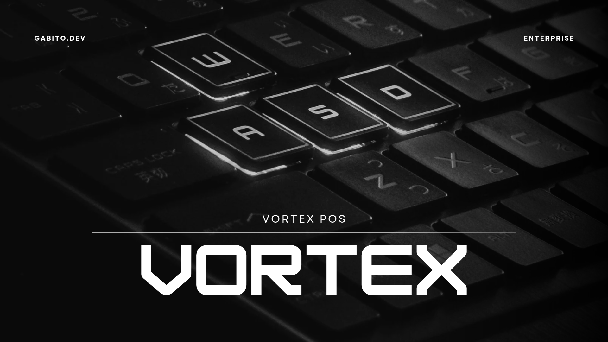

# Vortex POS



Punto de venta de la suite **Vortex** (**ERP, CRM, WMS, POS**): libre y de código abierto (AGPL-3.0), hecho en Perú
para LATAM y el mundo. Es una app **.NET MAUI Blazor Hybrid** para Windows, Android, iOS y macOS que **vende sin
conexión** y se integra con el resto de la suite a través del hub [vortex-api](https://github.com/ArcGabito/vortex-api).

## Qué hace

- **Vender**: búsqueda por nombre, SKU o código de barras (funciona con lectoras), artículos por categoría, cantidades,
  descuentos por línea y cliente opcional. Los totales desglosan el IGV (18 %) y respetan lo exonerado.
- **Cobrar** con efectivo (con vuelto y billetes rápidos), tarjeta, Yape/Plin, transferencia o crédito, y combinarlos.
- **Turnos de caja**: apertura con fondo inicial, cobrado por medio de pago y cierre con arqueo (esperado contra contado).
- **Ventas**: historial de todas las cajas de la organización, detalle, anulación con motivo, devoluciones parciales
  con reembolso en efectivo y exportación a CSV.
- **Catálogo compartido**: artículos, clientes y tiendas son los del hub; el stock por tienda es el que informa el WMS.
- **Varias cajas** en la misma organización: cada una numera sus documentos (`V-3F0C-000012`) y ve las ventas de las demás.

## Cómo encaja en la suite

| Con | El POS… |
|---|---|
| Hub | Inicia sesión (sin usuarios propios), sincroniza artículos, tiendas, clientes y datos de la empresa. |
| WMS | Publica `sale.completed`, `sale.voided` y `sale.returned` para que descuente o reponga stock; muestra el stock que publica (`stock.adjusted`). |
| ERP | Publica las mismas ventas para el registro de ingresos; muestra el comprobante que emite (`invoice.issued`). |
| CRM | Recibe `sale.completed` para el historial del cliente. |

Ninguno es obligatorio: sin WMS el POS vende igual (el stock se ve como "—"), y sin ERP las ventas quedan en el POS.
El detalle está en [docs/INTEGRACION.md](docs/INTEGRACION.md).

## Empezar

Requisitos: [.NET SDK 10](https://dotnet.microsoft.com/download) con el workload de MAUI
(`dotnet workload install maui`) y el hub corriendo en local (Docker).

```bash
git clone https://github.com/ArcGabito/vortex-api ~/vortex-api
cd ~/vortex-api && docker compose up -d && dotnet run --project src/VortexApi --launch-profile http   # http://localhost:5299

git clone https://github.com/ArcGabito/vortex-pos && cd vortex-pos
scripts/pack-sdk.sh                                                  # SDK del hub -> packages/vortex-sdk
dotnet test tests/VortexPos.Core.Tests                               # pruebas (no necesitan el hub)
dotnet run --project src/VortexPos -f net10.0-windows10.0.19041.0    # app en Windows (también -f net10.0-android)
```

En Windows con el hub dentro de WSL, empaqueta el SDK con `./scripts/pack-sdk.ps1`. Usuario demo:
`luis@vortex.local` / `Suite-Local-2026!` (en Debug, **Usar cuenta demo** en el login). La clave de sistema de
desarrollo es `vxp_pos_dev_key_change_me` y se cambia desde el login (**Servidor → Cambiar**).

Primeros pasos en la app: **Configuración → Tienda de esta caja**, luego **Turnos de caja → Abrir caja** y a **Vender**.

## Estructura

```
src/
├── VortexPos.Core/    Ventas, caja, datos maestros, sincronización y eventos (sin dependencias de MAUI)
└── VortexPos/         App MAUI Blazor Hybrid: pantallas, sesión con el hub y sistema de diseño
tests/
└── VortexPos.Core.Tests/
```

## Contribuir

Lee [CONTRIBUTING.md](CONTRIBUTING.md). `main` está protegida: los cambios entran por pull request con el CI en verde.
Para vulnerabilidades, [SECURITY.md](SECURITY.md).

## Licencia

[GNU AGPL-3.0](LICENSE.md). Si ofreces Vortex POS como servicio en red, debes publicar tus cambios.
